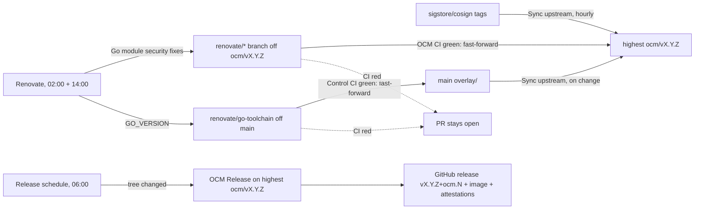

# Maintaining the fork

Everything runs from `main`. Only the highest maintenance branch `ocm/vX.Y.Z` is maintained: it
receives bot commits (overlay refreshes from Sync upstream, Go module security updates from
Renovate) plus the occasional reviewed [security patch](#security-patches). Older maintenance
branches are frozen: no updates, no overlay refresh, no scheduled releases. Nobody pushes to
maintenance branches by hand.

## Overview



## Where to look

| Question | Place |
|---|---|
| Are updates flowing? | [Renovate runs](https://github.com/open-component-model/cosign/actions/workflows/renovate.yml): the job summary names the base branches, the log lists every lookup and merge |
| What is stuck? | [Open Renovate PRs](https://github.com/open-component-model/cosign/pulls?q=is%3Apr+is%3Aopen+author%3Aapp%2Focmbot) (security ones labelled `security`) |
| What changed in a release? | Release notes: changes since the upstream tag, then the known vulnerabilities |
| Which vulnerabilities affect the current build? | Job summary of the `build` job in the latest OCM CI run of the branch, or the OpenVEX attestation of the image ([verification](verification.md#vulnerability-report-openvex)) |

## Schedules

| Workflow | File (on `main`) | Trigger | Runner |
|---|---|---|---|
| Sync upstream | `.github/workflows/sync-upstream.yml` | hourly at :17, pushes to `overlay/`/`hack/`, dispatch with `tag` | `ubuntu-slim` |
| Renovate | `.github/workflows/renovate.yml` | 02:00 and 14:00 UTC, pushes to `main`, dispatch; dry run (`extract`) on PRs changing its config | `ubuntu-26.04-arm` |
| Release schedule | `.github/workflows/release-schedule.yml` | daily 06:00 UTC | `ubuntu-slim` |
| Control CI | `.github/workflows/control-ci.yml` | pushes to `main` and `renovate/**`, PRs into `main`, weekly Monday 05:41 (cache seeding) | `ubuntu-slim`, `ubuntu-26.04-arm`, `ubuntu-26.04` |
| OCM CI | `overlay/.github/workflows/ocm-ci.yml` (on `ocm/v*`) | pushes to `renovate/**`, PRs into `ocm/v*`, called by OCM Release | `ubuntu-26.04-arm`, `ubuntu-26.04` (e2e) |
| OCM Release | `overlay/.github/workflows/ocm-release.yml` (on `ocm/v*`) | dispatched by Release schedule or by hand | `ubuntu-slim`, `ubuntu-26.04-arm` |

`schedule` only fires on the default branch, so Release schedule dispatches OCM Release on
the highest maintenance branch. Updates that went green after the 14:00 run are merged at
02:00, so the 06:00 release picks them up.

## Updates

Renovate is self-hosted (`.github/workflows/renovate.yml`, config `.github/renovate.json5`).
Each run processes two base branches: `main` and the highest `ocm/vX.Y.Z`. The workflow picks
the latter with `git ls-remote | sort -V` and passes it as force config (`RENOVATE_FORCE`),
which overrides `baseBranchPatterns` in the config file.

| Base branch | Updates | Source | Commit subject |
|---|---|---|---|
| highest `ocm/vX.Y.Z` | Go modules with a known vulnerability, direct and indirect, to the fixed version; `go mod tidy` | OSV and GitHub vulnerability alerts | `fix(deps): update module … [SECURITY]` |
| `main` | `GO_VERSION` in `overlay/.github/ocm/.env` | `golang-version` | `chore(deps): update go toolchain …` |

Every other dependency is disabled (`security:only-security-updates`). Renovate pushes each
update to a `renovate/…` branch. Once its CI passes (OCM CI for maintenance branches, Control
CI for `main`), the next run fast-forwards the base branch. When CI fails, Renovate opens a
PR instead.

A `GO_VERSION` merge on `main` changes `overlay/`, so Sync upstream propagates it to the
highest maintenance branch, and its next release ships it.

The `fix(deps)`/`chore(deps)` prefixes put the updates under "Dependencies" in the release
notes (`overlay/.github/ocm/cliff.toml`).

### Go module policy

- **No `go`/`toolchain` directive bumps.** Builds run with `GOTOOLCHAIN=local` and the Go
  version comes from `GO_VERSION`. A fix that needs a newer Go fails CI until the
  `go-toolchain` update has merged and Sync upstream has propagated it.
- **Vulnerability fixes are never excluded.** Alerts override every `enabled: false` rule, so
  a fix that needs cosign source changes is still proposed. Such a fix fails OCM CI and stays
  open as a PR; resolve it with a [security patch](#security-patches). Known cases:
  - `github.com/sigstore/**` moves in lockstep with cosign source: rekor v1.5.4 added
    `CreateLogEntryContext` to its generated client (the cosign mock no longer compiles), and
    timestamp-authority v2.1.3 broke the TSA e2e tests.
  - `github.com/ThalesIgnite/crypto11` was renamed to `github.com/ThalesGroup/crypto11` at
    v1.5.0. Bumps on the old path fail `go.sum` with a module-path mismatch (OCM #2966, #3379).

### Other pins

Everything else in `overlay/.github/ocm/.env` (kind, git-cliff, govulncheck, cyclonedx-gomod,
the Sigstore e2e services), the action SHAs in `.github/workflows/` and
`overlay/.github/workflows/`, and the base image in `overlay/.github/ocm/Containerfile` are
updated by hand through a PR into `main`. `GO_VERSION` is updated by Renovate through the
`# renovate: datasource=golang-version depName=go` comment above it.

### Fixing a failing update

- **Flaky test**: re-run the failed jobs of the branch's CI run. Once it is green, the next
  Renovate run merges it.
- **Code fix needed**: push a commit to the Renovate branch. Renovate then stops rebasing the
  branch. Merging into `ocm/v*` needs an org admin (`maintenance-branches` ruleset: only
  ocmbot and org admins may update those branches); PRs into `main` merge normally
  (`control-branch` ruleset). Use a rebase or fast-forward merge to keep the history linear.
  If the fix is a source change, record it under [security patches](#security-patches).
- **FIPS-only unit test failure**: see [below](#fips-only-unit-test-failures).

## Running things manually

```bash
# Renovate now
gh workflow run renovate.yml --repo open-component-model/cosign --ref main
# sync now / create a branch for an older tag
gh workflow run sync-upstream.yml --repo open-component-model/cosign --ref main
# release the highest maintenance branch (if changed) / one branch
gh workflow run release-schedule.yml --repo open-component-model/cosign --ref main
gh workflow run ocm-release.yml --repo open-component-model/cosign --ref ocm/v3.1.4
```

Preview Renovate's security lookups for a maintenance branch locally (nothing is pushed).
`--platform=local` reads the config from committed files only, hence the throwaway commit:

```bash
git worktree add --detach /tmp/preview origin/ocm/v3.1.4
cd /tmp/preview
cp "$OLDPWD/.github/renovate.json5" renovate.json5
git add renovate.json5 && git commit -qm 'tmp: renovate config'
GITHUB_COM_TOKEN="$(gh auth token)" LOG_LEVEL=debug npx --yes renovate --platform=local --dry-run=lookup
cd - && git worktree remove --force /tmp/preview
```

## Adding a maintenance branch for an older tag

Tags below `v3.1.3` get no branch automatically. To create one for any mirrored
stable tag:

```bash
gh workflow run sync-upstream.yml --repo open-component-model/cosign --ref main -f tag=v2.6.5
```

Such a branch is frozen like every branch below the highest one: release it by hand with
OCM Release.

## Security patches

A vulnerability that Renovate cannot fix (the vulnerable module is unmaintained and has no
fixed version, or the fixed version needs cosign source changes, see the
[Go module policy](#go-module-policy)) gets a source patch, merged through a PR into the
maintenance branch. Prefer the change upstream already proposes, so the patch disappears
once upstream releases it. New maintenance branches start from the upstream tag: re-apply
the patch there unless that tag already contains the fix.

| Branch | Vulnerability | Patch | Upstream |
|---|---|---|---|
| `ocm/v3.1.3` | [GO-2026-6225](https://pkg.go.dev/vuln/GO-2026-6225): `chrismellard/docker-credential-acr-env` sends Azure tokens to any host containing `.azurecr.io` | ACR credential helper replaced by `github.com/osscontainertools/docker-credential-acr` | [sigstore/cosign#5099](https://github.com/sigstore/cosign/pull/5099) |
| `ocm/v3.1.3` | [GO-2026-5932](https://pkg.go.dev/vuln/GO-2026-5932): deprecated `golang.org/x/crypto/openpgp`, linked in by rekor v1.5.3 `pkg/pki/pgp` | rekor v1.5.4 (ProtonMail/go-crypto) plus the rekor mock and client changes from upstream | [sigstore/cosign#5104](https://github.com/sigstore/cosign/pull/5104) (merged, not yet released) |

## FIPS-only unit test failures

If a unit test fails under `GOFIPS140=certified` but passes with
`GOFIPS140=off` on the same commit, add it to `FIPS_SKIP_TESTS` (a `go test -skip`
regex) in `overlay/.github/ocm/.env`. Never skip e2e failures: they mean the
shipped binary is broken for that feature.

## Why security-only

Updating every Go module daily on every maintenance branch released far too often (`ocm/v3.1.3`
reached `+ocm.35`). Releases now only follow security fixes, Go toolchain updates and overlay
changes on the highest branch. Dependabot security updates cannot replace Renovate here: they
only target the default branch `main`, which has no `go.mod`. Renovate's OSV alerts work on
any base branch.
