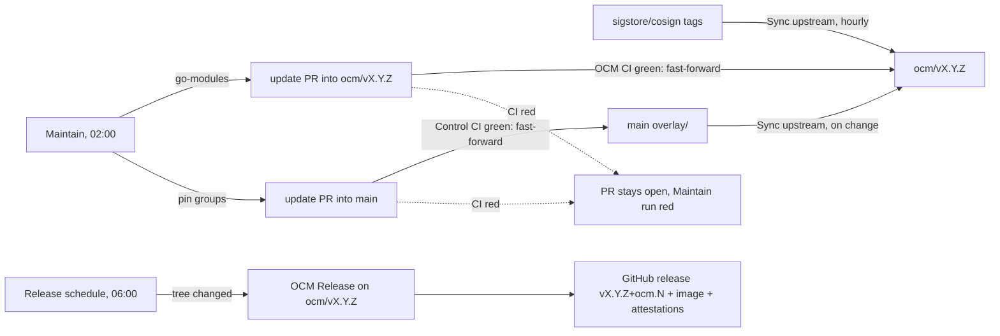

# Maintaining the fork

Everything runs from `main`. Maintenance branches `ocm/vX.Y.Z` receive bot commits —
overlay refreshes (Sync upstream) and dependency updates (Maintain) — plus the occasional
reviewed [security patch](#security-patches). Nobody pushes to them by hand.

## Overview



## Where to look

| Question | Place |
|---|---|
| Are updates flowing? | [Maintain runs](https://github.com/open-component-model/cosign/actions/workflows/maintain.yml): the summary of each run lists every target with its PR, CI result and merge |
| What is stuck? | [Open update PRs](https://github.com/open-component-model/cosign/pulls?q=is%3Apr+is%3Aopen+label%3Adependencies) (label `dependencies`) |
| What changed in a release? | Release notes: changes since the upstream tag, then the known vulnerabilities |
| Which vulnerabilities affect the current build? | Job summary of the `build` job in the latest OCM CI run of the branch, or the OpenVEX attestation of the image ([verification](verification.md#vulnerability-report-openvex)) |

## Schedules

| Workflow | File (on `main`) | Trigger | Runner |
|---|---|---|---|
| Sync upstream | `.github/workflows/sync-upstream.yml` | hourly at :17, pushes to `overlay/`/`hack/`, dispatch with `tag` | `ubuntu-slim` |
| Maintain | `.github/workflows/maintain.yml` | daily 02:00 UTC (weekly groups on Sundays), dispatch with `weekly` | `ubuntu-slim` (plan) |
| Bump | `.github/workflows/bump.yml` | called by Maintain per target, or dispatched for one update | `ubuntu-26.04-arm` |
| Release schedule | `.github/workflows/release-schedule.yml` | daily 06:00 UTC | `ubuntu-slim` |
| Control CI | `.github/workflows/control-ci.yml` | pushes to and PRs into `main`, weekly Monday 05:41 (cache seeding) | `ubuntu-slim`, `ubuntu-26.04-arm`, `ubuntu-26.04` |
| OCM CI | `overlay/.github/workflows/ocm-ci.yml` (on `ocm/v*`) | PRs into `ocm/v*`, called by OCM Release | `ubuntu-26.04-arm`, `ubuntu-26.04` (e2e) |
| OCM Release | `overlay/.github/workflows/ocm-release.yml` (on `ocm/v*`) | dispatched by Release schedule or by hand | `ubuntu-slim`, `ubuntu-26.04-arm` |

`schedule` only fires on the default branch, so Release schedule dispatches OCM Release on
each maintenance branch. Maintain finishes its merges well before 06:00, so a release picks
them up the same day.

## Update groups

| Slug | Target | When | Changes | Commit subject |
|---|---|---|---|---|
| `go-modules` | every `ocm/vX.Y.Z` | daily | `go.mod`, `go.sum` ([policy](#go-module-policy)) | `fix(deps): update go modules` |
| `go-toolchain` | `main` | daily | `GO_VERSION` in `overlay/.github/ocm/.env` | `chore(deps): update go toolchain` |
| `test-tooling` | `main` | Sundays | kind, git-cliff, govulncheck, cyclonedx-gomod pins in the overlay `.env` | `chore(deps): update test tooling` |
| `sigstore-e2e-services` | `main` | Sundays | fulcio, rekor, timestamp-authority, rekor-tiles pins (e2e) | `chore(deps): update sigstore e2e services` |
| `github-actions` | `main` | Sundays | action SHAs in `.github/workflows/` and `overlay/.github/workflows/` ([pinact](https://github.com/suzuki-shunsuke/pinact), majors included), `PINACT_VERSION` in `hack/tools.env` | `chore(deps): update github actions` |
| `base-images` | `main` | Sundays | `FROM` digests in `overlay/.github/ocm/Containerfile` (tag kept) | `chore(deps): update container base images` |

Maintenance branches are updated in parallel. The `main` groups run one after another,
each on top of the previous merge. A `main` merge that touches `overlay/` reaches the
maintenance branches through Sync upstream; their next release ships it.

The `fix(deps)`/`chore(deps)` prefixes put the updates under "Dependencies" in the release
notes (`overlay/.github/ocm/cliff.toml`).

## Go module policy

`hack/bump-go-modules.sh` updates every module listed in `go.mod`, direct and indirect, to its
newest version with these exceptions:

| Rule | Why |
|---|---|
| No new majors | `go list -m -u` never crosses a module path; a new major needs cosign source changes, which arrive with new upstream tags (new maintenance branches). |
| No `v0` → `v1` | Same module path for Go, but a breaking release in semver terms (e.g. `golang/snappy v0.0.4 → v1.0.0`). |
| No `github.com/sigstore/**` | The cosign ecosystem moves in lockstep with cosign source: rekor v1.5.4 added `CreateLogEntryContext` to its generated client (the cosign mock no longer compiles), timestamp-authority v2.1.3 broke the TSA e2e tests. |
| No `github.com/ThalesIgnite/crypto11` | Renamed to `github.com/ThalesGroup/crypto11` at v1.5.0; bumps on the old path fail `go.sum` with a module-path mismatch (OCM #2966, #3379). |
| No `github.com/googleapis/gax-go/v2` | v2.27.0 requires a `google.golang.org/genproto` without `googleapis/cloud/kms/v1`, which tink-go-gcpkms v2.4.0 tests (via timestamp-authority) still import; `go mod tidy` fails. Lift once tink-go-gcpkms or timestamp-authority drop that import. |
| No indirect pseudo-version jumps | Untagged indirect modules follow their importers via MVS; jumping to their default-branch tip breaks version sets (`k8s.io/kube-openapi` tip needs `structured-merge-diff/v7` while apimachinery passes v6 types; `google.golang.org/genproto` tip dropped a package tink-go-gcpkms still imports). |
| Go version from `GO_VERSION` | Runs with `GOTOOLCHAIN=local`; the `go`/`toolchain` directives are never bumped on purpose. A module that needs a newer Go fails the update until the `go-toolchain` update has merged and Sync upstream has propagated it. |

All allowed updates go into one `go get`, followed by `go mod tidy`. The commit body is a
`module | from | to` table. This produces exactly what the earlier Renovate setup did
(verified byte-for-byte on `ocm/v3.1.3`).

## Pin format

Pins live in `overlay/.github/ocm/.env` (shipped to maintenance branches) and `hack/tools.env`
(control-only tools). A comment marks the pin on the next line:

```bash
# bump: <group> <source> [<name>]
NAME=value
```

| Source | Latest version from |
|---|---|
| `go` | `https://go.dev/dl/?mode=json`, first entry, without the `go` prefix |
| `github-release <owner/repo>` | `gh release view -R <owner/repo>`: the release GitHub marks as latest (no drafts or prereleases) |
| `go-module <path>` | `https://proxy.golang.org/<path>/@latest` |

To add a pin, add the comment and the `NAME=value` line with an existing group; the next run of
that group picks it up. A new group also needs a case in `hack/bump-pins.sh`, an entry in
`PIN_GROUPS` in `hack/bump.sh` and in the `plan` job of `maintain.yml`.

## Update PRs

Each update is one branch `bump/<target>/<slug>` and one PR into `<target>`, labelled
`dependencies` and opened by ocmbot. `hack/bump.sh` drives it in three steps of the Bump workflow:

1. **open**: runs the updater on the current head of the target.
   - Nothing to update: deletes a leftover bump branch, which closes its PR.
   - Same update as last time (same base, same tree): keeps the existing commit, so CI is not
     re-run on a fresh push.
   - Otherwise: force-pushes a single new commit, then opens the PR or updates its title and body.
2. **wait**: follows the PR's CI run (`OCM CI` for maintenance branches, `Control CI` for
   `main`). If the run already failed on an earlier day, its failed jobs are re-run once,
   which retries flakes daily.
3. **merge**: pushes the PR commit to the target as a fast-forward. GitHub records the PR as
   merged, and the bump branch is deleted.

| Situation | Result |
|---|---|
| CI green | merged, branch deleted |
| CI red | PR stays open, Bump job and Maintain run fail; tomorrow's run rebuilds the update (newer versions may fix it) or retries the failed jobs |
| Target moved while CI ran (typically Sync upstream propagating a `main` overlay change) | a new [Bump run](https://github.com/open-component-model/cosign/actions/workflows/bump.yml) starts at once and rebuilds the PR on the new head; if that one loses the race too, the PR waits for the next Maintain run |
| Someone pushed to the bump branch | left alone: no rebuild, no auto-merge |

### Fixing a failing update PR

- **Flaky test**: nothing to do. The next run re-runs the failed jobs. To retry now, run
  `gh workflow run bump.yml --ref main -f target=<target> -f slug=<slug>`.
- **One module breaks the build**: decide whether it is a policy case. Lasting exclusions go into the
  jq filter of `hack/bump-go-modules.sh`, with a reason, and into the table above. The next run
  rebuilds the PR without it.
- **Code fix needed**: push a commit to the bump branch. From then on the PR belongs to you:
  Maintain no longer touches it and it is not auto-merged. Merging into `ocm/v*` needs an org
  admin (`maintenance-branches` ruleset: only ocmbot and org admins may update those branches);
  PRs into `main` merge normally (`control-branch` ruleset). Use a rebase or fast-forward
  merge to keep the history linear. Once merged, delete the branch: Maintain resumes with the
  next run.
- **FIPS-only unit test failure**: see [below](#fips-only-unit-test-failures).

## Running things manually

```bash
# all updates now (with the weekly main groups)
gh workflow run maintain.yml --repo open-component-model/cosign --ref main -f weekly=true
# one update
gh workflow run bump.yml --repo open-component-model/cosign --ref main -f target=ocm/v3.1.3 -f slug=go-modules
# sync now / create a branch for an older tag
gh workflow run sync-upstream.yml --repo open-component-model/cosign --ref main
# release every changed maintenance branch / one branch
gh workflow run release-schedule.yml --repo open-component-model/cosign --ref main
gh workflow run ocm-release.yml --repo open-component-model/cosign --ref ocm/v3.1.3
```

Preview an update locally (nothing is pushed):

```bash
git worktree add --detach /tmp/preview origin/ocm/v3.1.3
cd /tmp/preview
BUMP_MSG=/tmp/msg GOTOOLCHAIN=go$(grep -E '^GO_VERSION=' .github/ocm/.env | cut -d= -f2-) \
  "$OLDPWD/hack/bump-go-modules.sh"
cat /tmp/msg; git diff --stat
# main pins, from a main checkout:
BUMP_MSG=/tmp/msg GH_TOKEN="$(gh auth token)" hack/bump-pins.sh test-tooling
```

`hack/bump.sh` accepts `REPO_URL=file:///path/to/bare.git` to try the whole open/merge flow
against a local bare clone.

## Adding a maintenance branch for an older tag

Tags below `v3.1.3` get no branch automatically. To create one for any mirrored
stable tag:

```bash
gh workflow run sync-upstream.yml --repo open-component-model/cosign --ref main -f tag=v2.6.5
```

## Security patches

A vulnerability that the Maintain bump cannot fix (the vulnerable module is unmaintained and
has no fixed version, or the fixed version is excluded by the [Go module policy](#go-module-policy)
because it needs cosign source changes) gets a source patch, merged through a PR into the
maintenance branch. Prefer the change upstream already proposes, so the patch disappears
once upstream releases it. New maintenance branches start from the upstream tag: re-apply
the patch there unless that tag already contains the fix.

| Branch | Vulnerability | Patch | Upstream |
|---|---|---|---|
| `ocm/v3.1.3` | [GO-2026-6225](https://pkg.go.dev/vuln/GO-2026-6225): `chrismellard/docker-credential-acr-env` sends Azure tokens to any host containing `.azurecr.io` | ACR credential helper replaced by `github.com/osscontainertools/docker-credential-acr` | [sigstore/cosign#5099](https://github.com/sigstore/cosign/pull/5099) |
| `ocm/v3.1.3` | [GO-2026-5932](https://pkg.go.dev/vuln/GO-2026-5932): deprecated `golang.org/x/crypto/openpgp`, linked in by rekor v1.5.3 `pkg/pki/pgp` | rekor v1.5.4 (ProtonMail/go-crypto) plus the rekor mock and client changes from upstream | [sigstore/cosign#5104](https://github.com/sigstore/cosign/pull/5104) (merged, not yet released) |

## FIPS-only unit test failures

If a unit test fails under `GOFIPS140=certified` but passes with
`GOFIPS140=off` on the same commit, add it to `FIPS_SKIP_TESTS` (a `go test -skip`
regex) in `overlay/.github/ocm/.env`. Never skip e2e failures: they mean the
shipped binary is broken for that feature.

## Why not Renovate

Renovate used to do these updates. Most of its configuration re-implemented Go's own rules
(module-path majors, MVS for indirect modules, `go mod tidy`), and every quirk needed another
package rule. Its extras do not apply here: a dependency dashboard and OSV alerts on
non-default branches are replaced by update PRs and govulncheck. The scripts above produce
the same updates with one mechanism, which you can run and debug locally.
